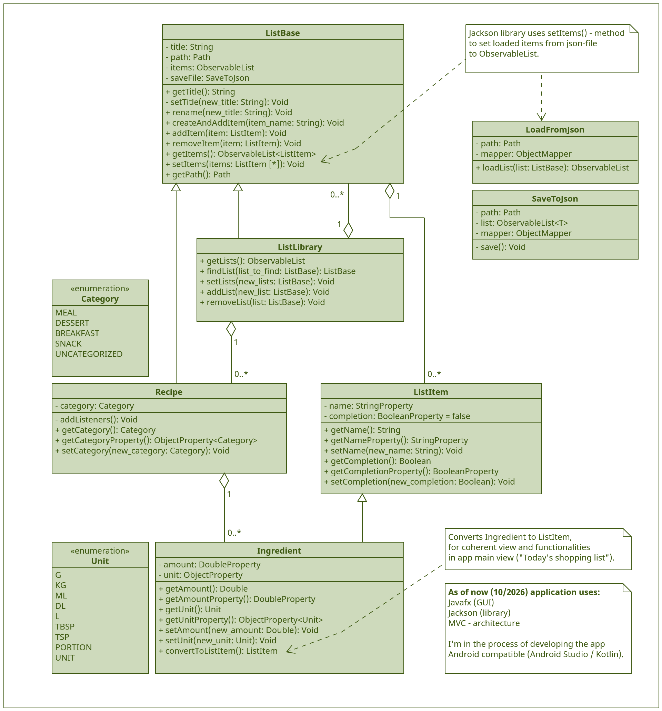
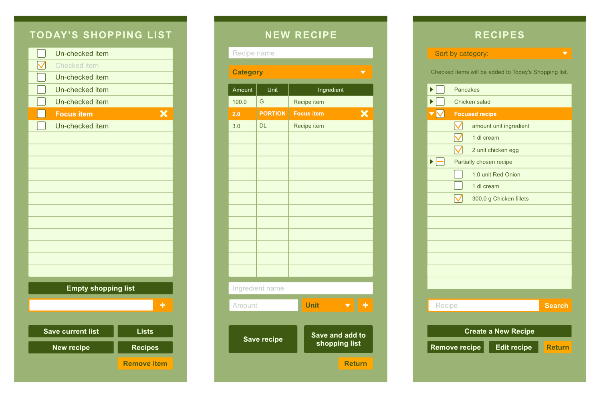

# ListsApp - dev branch

See branch [master](https://github.com/kaipiip/ListsApp/tree/master) for working desktop app.
The desktop app was an exercise assignment for the Programming 2 (Object-Oriented Programming)
course at the University of Jyväskylä in spring 2026.

This branch is used to develop the app further, refactoring architecture for less repetitive code and
building a mobile version (Android) of the app.

## UML Class Diagram

## Visual design idea
